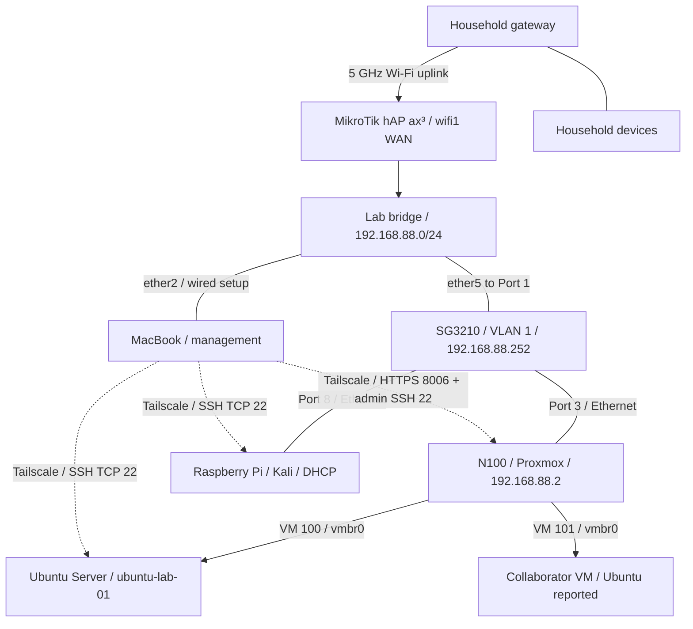

# HomeLab — Networking and Virtualization

I'm building a home lab to turn my CompTIA Network+ studies into practical experience with networking, Linux, virtualization, and security. This repository documents the build from hardware preparation and MikroTik configuration through Proxmox installation, switch integration, firewall isolation, remote Linux administration with Tailscale, and hardening the MacBook used to manage the lab.

The focus is on the decisions, troubleshooting, and results: what I changed, why I changed it, what I verified, and what still needs work.

**Latest documented milestone:** VM 100's backup passed checksum comparison and an isolated restore/boot test. Daily 02:00 backups with `keep-last=3` completed successfully, including the observed scheduled run. Selected Tailscale allow/deny paths were checked and the policy JSON saved. PR #1 was merged into `main`. Switch HTTP was disabled; a post-reboot NTP failure was resolved with new time servers and another reboot check. Pi SSH password authentication was disabled, effective settings verified, and a fresh administrator key login succeeded. A collaborator reconnect after the final Pi SSH change remains unrecorded.

*Latest documented work and README update: November 7, 2026. This overview covers Phases 1–12. Earlier snapshots describe the end of each phase; Phase 12 records the latest changes. This is a lab record, not a live inventory.*

## Project documentation

| Phase | What it covers | Outcome at the end of that phase |
| --- | --- | --- |
| [01 — Planning, Hardware, and Preparation](docs/01-planning-and-hardware.md) | Equipment, installation prerequisites, workspace constraints, the unknown Windows software baseline, and initial household-network checks | Core equipment received; dedicated router and clean server installation selected |
| [02 — MikroTik Wireless WAN and Lab Network Setup](docs/02-network-setup.md) | Station-mode uplink, bridge membership, DHCP, WAN interface lists, NAT, and USB preparation | Internet browsing verified from the wired MacBook; Proxmox USB prepared |
| [03 — Proxmox VE Installation](docs/03-proxmox-installation.md) | USB boot, disk selection, management NIC and static IP, hostname discrepancy, first local login, and shutdown | Proxmox installed and booted; local root login succeeded |
| [04 — Switch Integration and Proxmox Operations](docs/04-switch-and-proxmox-operations.md) | Confirmed cabling, layered connectivity tests, Safari access, repository authorization failures, updates, reboot, and storage checks | Switch path and browser login verified; host updated; cable organization and first VM still pending |
| [05 — Lab Isolation and Firewall Troubleshooting](docs/05-lab-isolation-and-firewall.md) | Power reconnection, flat-LAN decisions, upstream checks, IPv4/IPv6 forwarding rules, Safe Mode rollback, and macOS route troubleshooting | Rules saved; household-gateway drop verified by counters; Tailscale and broader isolation tests pending |
| [06 — Raspberry Pi, Tailscale, and Remote Access](docs/06-raspberry-pi-and-tailscale.md) | DHCP discovery, headless SSH, Tailscale account migration, external access, policy restrictions, user accounts, Kali updates, and reboot checks | Remote SSH verified; policy saved; Pi updated; collaborator VPN access pending |
| [07 — MacBook Hardening and Switch Management](docs/07-macbook-hardening-and-switch-management.md) | MacBook firewall and permissions, switch browser access, hardware/VLAN inspection, DHCP reservation, port descriptions, Save, and configuration exports | MacBook baseline improved; switch management established and backed up; shared VLAN 1 retained |
| [08 — Shared Remote Access and the First Ubuntu VM](docs/08-shared-remote-access-and-ubuntu-vm.md) | Collaborator identity troubleshooting, remote Proxmox, separate accounts, Ubuntu installation, guest updates, and SSH-key validation | Collaborator Pi SSH and remote Proxmox verified; first VM running; key login works; key-only authentication and VM backup pending |
| [09 — VM Permissions, PHP Review, and SSH Hardening](docs/09-vm-permissions-php-review-and-ssh-hardening.md) | Scoped Proxmox pool/storage/network roles, VM 101 task review, PHP package and service checks, targeted Kali update, and Ubuntu SSH hardening | VM creation observed under collaborator account; PHP updated on Pi; Ubuntu key login works and password-only login is rejected; backups and guest/boundary checks pending |
| [10 — Network Hardening and Router Update](docs/10-network-hardening-and-router-update.md) | Effective permissions and storage checks, Pi sudo access, Nmap/tcpdump practice, NTP/time zone, management-service hardening, encrypted backup, RouterOS/RouterBOOT updates, and post-reboot checks | RouterOS and RouterBOOT at 7.23.8; five selected router ports closed after reboot; switch Telnet closed; Pi time synchronized; ISO assignment, guest storage diagnosis, and recovery tests pending |
| [11 — NTP Verification, Operations Planning, and Off-Device Backups](docs/11-ntp-operations-and-backups.md) | NTP ticket validation, Proxmox SSH, management-tool planning, PR-branch updates, post-update router backup, and VM 100 backup transfer | Three systems checked directly and collaborator VM reported working; router and VM backups downloaded; restoration, scheduling, and deployment verification pending |
| [12 — Recovery Testing, Access Validation, and SSH Hardening](docs/12-recovery-access-and-hardening.md) | Archive checksums, isolated restore, daily backups, access tests, PR merge, switch HTTP/NTP, and Pi key-only SSH | Restore and scheduled backup verified; switch time correct after reboot; Pi administrator key login works with password authentication disabled |

## Lab hardware

| Component | Role and recorded details |
| --- | --- |
| PELADN WI-6 mini PC | Proxmox host: Intel N100, 4 cores, 8 GB RAM, 256 GB SSD |
| MikroTik hAP ax³ | Lab router, US version; 5 GHz Wi-Fi uplink and a separate lab LAN; RouterOS and RouterBOOT 7.23.8 verified in Phase 10 |
| TP-Link TL-SG3210 JetStream | SG3210 hardware 3.20; 8 Gigabit copper ports + 2 SFP slots; Port 1 uplink, Port 3 to Proxmox, Port 8 to Pi; management `192.168.88.252` reserved through DHCP |
| MacBook Pro with UGREEN USB-C hub | `MacBookPro16,1`, 8-core Intel Core i9, 16 GB RAM; local lab administration and Tailscale/SSH management; FileVault on and firewall enabled |
| SanDisk USB drive | Proxmox installation media, written using Raspberry Pi Imager |
| Monitor and keyboard | Local installation and console access |
| Raspberry Pi | Headless Kali Rolling 2026.2 ARM64 client; LAN address assigned by DHCP; Tailscale endpoint for remote SSH |

Phase 7 confirmed the switch as **SG3210 hardware 3.20** and inspected its existing **VLAN 1 / PVID 1** configuration. All ten listed interfaces, including the two SFP slots, were untagged members of that VLAN. Phase 6 confirmed the Pi's Kali installation and connection on **Port 8**. The Pi serves as a lab client and remotely accessible endpoint; it is not configured as a subnet router.

## Network layout

The MikroTik joins the household network through its 5 GHz radio, `wifi1`, in **station** mode. Its lab LAN uses `192.168.88.0/24`. The switch connects the N100 on Port 3 and the Pi on Port 8. The MacBook uses router `ether2` for wired setup; remote Pi access was also verified with that cable disconnected.

| Physical connection | Confirmed mapping |
| --- | --- |
| Router → switch | MikroTik `ether5` → Switch Port `1` |
| Switch → server | Switch Port `3` → N100 Ethernet |
| Management computer → router | MacBook Ethernet adapter → MikroTik `ether2` during wired setup |
| Switch → Raspberry Pi | Switch Port `8` → Pi `eth0` |

| Setting | Latest documented value |
| --- | --- |
| MikroTik LAN address / gateway | `192.168.88.1` |
| MikroTik management | SSH and Winbox retained; Telnet, FTP, HTTP, and both API services disabled; HTTPS WebFig remains disabled |
| Lab DHCP pool | `192.168.88.10`–`192.168.88.254` |
| Proxmox static address | `192.168.88.2/24` |
| Pi LAN address | DHCP; `192.168.88.250` observed in Phase 10, not a configured reservation |
| Ubuntu VM 100 LAN address | `192.168.88.249/24` observed in Phases 8–9; dynamic DHCP snapshot |
| Collaborator VM address | Not established in this record; working Ubuntu reported; historical VM 101 operations do not establish the current guest ID or a complete inventory |
| Switch management address | `192.168.88.252`; static DHCP lease on MikroTik, switch remains a DHCP client |
| Switch management URL | `https://192.168.88.252`; HTTPS login verified; HTTP disabled and observed disabled after reboot; certificate trust warning remains |
| Switch VLAN / PVID | VLAN 1 (`System-VLAN`), untagged ports `1/0/1`–`1/0/10`; PVID 1 throughout |
| Proxmox configured gateway / DNS | `192.168.88.1` |
| Proxmox management interface | `nic0`, Ethernet driver `r8169` |
| Proxmox management URL | `https://192.168.88.2:8006` — login verified through Safari |
| Router LAN bridge members | `ether2`–`ether5`, `wifi2` |
| Router WAN interface-list members | `ether1`, `wifi1`; `ether1` unused during setup |

Phase 5 added an IPv4 forward drop to the household subnet, a drop for new forwarded WAN connections, and an IPv6 forward drop before FastTrack6. The household-gateway client test matched **3 packets / 252 bytes**; saving the rules was confirmed. Deliberate inbound-WAN and routed-IPv6 tests remain pending. Existing general internet egress was retained; this is not an update-repository allowlist. Phase 10 verified the recorded rules and LAN/WAN memberships after the router updates, but did not repeat the household-counter or deliberate WAN/IPv6 traffic tests. The bridge and internal single-LAN design remain unchanged.

The dotted edges represent Tailscale connections, not additional physical cables. Each endpoint runs its own Tailscale client. Remote SSH was tested from a phone hotspot and from household Wi-Fi. No public port forward or advertised lab-subnet route was added. Tailscale policy controls the overlay path; it does not isolate devices sharing the lab LAN.

## Troubleshooting highlights

| Problem | Change made | Observed result |
| --- | --- | --- |
| DHCP client could not run on `wifi1` because it remained a bridge member | Removed only `wifi1` from the LAN bridge | Upstream DHCP lease obtained |
| Router had an upstream address, but the wired client could not browse | Added `wifi1` to the WAN list used by the existing masquerade rule | Browsing succeeded from the MacBook on `ether2` |
| balenaEtcher could not open the ISO | Switched to Raspberry Pi Imager / Use Custom | Installation USB written successfully |
| Startup key attempts did not reach the USB boot menu | Used Windows Shift + Restart and selected UEFI USB PARTITION 2 | Proxmox installer started |
| Installer addressing did not match the lab network | Set `192.168.88.2/24`, outside the DHCP pool | Installed system displayed the expected management URL |
| Chrome could not reach Proxmox in Phase 4 | Checked ping, TCP 8006, and HTTPS, then used Safari | Safari login succeeded; Proxmox access from Chrome was not retested in Phase 7 |
| Update task failed with exit code 100 | Ran `apt update` on Proxmox; found 401 errors; disabled PVE/Ceph Enterprise and added PVE No-Subscription | Refresh returned TASK OK; later upgrade completed |
| First upgrade attempt aborted at confirmation | Retried with guidance to use the default confirmation or English `y` | Upgrade completed; subsequent reboot and new kernel were verified |
| Cable unplugged while RouterOS was in Safe Mode | Inspected rule presence and history, then reapplied missing rules | Rollback confirmed; final changes later saved |
| Household ping timed out but the drop counter stayed at zero | Inspected macOS routes; disabled the Wi-Fi network service for the Ethernet-only test | Household drop counter increased to 3 packets / 252 bytes |
| First SSH connection to the Pi closed before a password prompt | Retried with `ssh -v` and inspected the handshake | Password login succeeded; original closure remained unexplained |
| Pi was already enrolled in a collaborator's tailnet | Logged it out over the LAN session and authenticated it into my own account | Pi and MacBook joined the same owner-controlled tailnet |
| Tailnet policy allowed unrestricted connections | Backed up the policy and limited access to the specified MacBook → Pi TCP 22 | Policy saved; a fresh SSH login succeeded |
| Collaborator account password failed during creation | Completed account creation, then set its password separately | Login and UID/group checks succeeded from my authorized MacBook |
| Post-reboot login rejected several passwords | Corrected a typing error | Remote SSH worked again; no firewall or VPN reset needed |
| Chrome could not reach the switch despite successful ping and TCP 80/443 checks | Enabled Chrome's macOS Local Network permission | HTTPS switch login became reachable; its certificate trust warning remained |
| Switch management depended on a dynamic lease | Converted the matching DHCP lease to static on MikroTik | Address remained `192.168.88.252`, status `bound`, with the entry's `D` flag removed |
| Port numbers alone made equipment identification inconvenient | Added descriptions for Ports 1, 3, and 8, then used Save and Export | Main connections labeled; updated switch backup downloaded |
| Collaborator could sign into Proxmox but could not create VMs | Added a pool and scoped pool, storage, and network roles | Create VM became available; later Tasks showed VM 101 creation under that account |
| Proxmox TCP 8006 timed out during one remote session | Access later recovered; no confirmed fix or root cause | Work resumed; the transient failure was recorded without attributing it to a specific component |
| PHP packages were installed on Kali while Apache was inactive | Simulated and applied a seven-package update | PHP CLI reported 8.4.27; Apache remained inactive |
| SSH treated the private-key file as a PKCS#11 provider | Corrected uppercase `-I` to lowercase `-i` | Key-based authentication succeeded |
| Ubuntu still accepted SSH passwords despite a working key | Added a local configuration file, checked effective settings, and reloaded SSH | Fresh key login succeeded; password-only attempt was denied |
| Collaborator reported upload and storage limitations | Read effective permissions and host storage; created an ISO-upload role | Disk permissions and free host space were already present; role assignment, upload, and guest storage diagnosis remain pending |
| Pi clock appeared wrong | Checked NTP status and changed the local zone to `America/Chicago` | Synchronization was already working; local time now displayed CDT without opening inbound UDP 123 |
| Nmap found reachable Telnet on router and switch | Disabled each device's Telnet service after establishing another management path | Both reported closed; router TCP 23 remained closed after its updates |
| Router exposed unused FTP, HTTP, and API listeners to the lab | Disabled the corresponding RouterOS services | TCP 21, 80, 8728, and 8729 reported closed, including after both reboots |
| Initial router SFTP transfer failed through the Pi | Retried with the cipher seen in a successful SSH session | Encrypted backup downloaded; original failure's cause remained unproven |
| RouterOS updated while boot firmware still showed the old version | Applied the separate RouterBOOT update and rebooted again | Active RouterOS and RouterBOOT versions both verified as 7.23.8 |

## Proxmox snapshot after the Phase 4 upgrade

The following values were recorded on October 7, 2026. They describe that session, not a continuously monitored state or a recommendation to install a particular version.

| Item | Recorded value |
| --- | --- |
| Proxmox Manager | `pve-manager/9.2.21` |
| Running kernel | `Linux 7.0.14-20-pve` |
| Boot mode | EFI |
| Active repositories | Debian + Debian security + PVE No-Subscription |
| Disabled repositories | PVE Enterprise and Ceph Squid Enterprise |
| `local` | `72.73 GB` total; `6.24 GB` used |
| `local-lvm` | `151.66 GB` total; `0 B` used |
| Guests | No VM or container created yet |

The No-Subscription production-use warning remained visible. A new package-list refresh after the post-reboot inspection was not recorded; the successful upgrade is documented in Phase 4.

## Raspberry Pi snapshot after Phase 6

Recorded on October 10, 2026:

| Item | Recorded state |
| --- | --- |
| OS / architecture | Kali Rolling 2026.2 / ARM64 |
| Running kernel after reboot | `6.12.34+rpt-rpi-2712`; unchanged from the initial check |
| Remote access | Ordinary OpenSSH over Tailscale, with Linux password authentication |
| External test | Fresh login from phone hotspot with Ethernet disconnected |
| Policy | Specified MacBook → Pi TCP 22; collaborator access not yet granted |
| Accounts | Administrator password changed; separate collaborator account created, UID/GID 1004, no `sudo` group membership shown |
| Approved upgrade plan | 1461 upgrades, 80 installs, 2 removals, 1 package not upgraded |
| Package consistency checks | `dpkg --audit` returned no findings; `apt-get check` completed without errors before reboot |
| Post-reboot checks | `ssh` and `tailscaled` active; no failed systemd units |

The account and service review was a basic security baseline, not proof that the Pi was free of malware. At the end of Phase 6, the collaborator-account test had only been performed from my MacBook. Phase 8 subsequently verified SSH from the collaborator’s own computer; Phase 10 later added that account to the Pi's `sudo` group. The exact policy structure, test results, and remaining limits are recorded in [Phase 6](docs/06-raspberry-pi-and-tailscale.md).

## MacBook and switch snapshot after Phase 7

Recorded during October 10–15, 2026:

| Area | Documented state |
| --- | --- |
| MacBook baseline | macOS `26.7.1`, build `25G241`; no DEP/MDM enrollment reported |
| MacBook protection | FileVault already on; firewall enabled; login password changed; automatic login off |
| App permissions | Chrome/Zoom microphone and reviewed camera permissions off; Zoom screen recording and background activity disabled |
| Previous owner's data | Preserved; backup confirmation required before deletion |
| Switch identity | SG3210 hardware `3.20`; System Summary firmware `3.20.0 Build 20230818 Rel.72032` |
| Switch management | HTTPS login reached; new password set; management address reserved in MikroTik DHCP |
| Network configuration | Shared VLAN 1 and PVID 1 inspected and retained; no inter-VLAN routing added |
| Port descriptions | `1/0/1`: `MikroTik-ether5`; `1/0/3`: `Proxmox-N100`; `1/0/8`: `RaspberryPi-Kali` |
| Configuration handling | Save confirmed; initial and updated switch exports downloaded |
| Remaining checks | Certificate trust, management services, time settings, firmware review, restart persistence, and restore test |

The switch export does not include its DHCP reservation, which lives on the MikroTik. Phase 10 subsequently downloaded an encrypted router backup before upgrading it; Phase 11 added a downloaded post-upgrade backup. A sanitized text export and recovery test remain open. The Chrome fix was verified against the switch; it did not constitute a new Proxmox browser test. See [Phase 7](docs/07-macbook-hardening-and-switch-management.md) for the evidence and limits.

## Remote access and Ubuntu snapshot after Phase 8

Recorded during October 15–20, 2026. The overlay addresses below are examples, consistent with earlier public documentation.

| Endpoint | Example Tailscale address | Allowed initiators / service |
| --- | --- | --- |
| Raspberry Pi | `100.101.10.10` | My MacBook and collaborator identity / TCP 22 |
| Proxmox host | `100.101.10.30` | My MacBook and collaborator identity / TCP 8006 |
| Ubuntu VM | `100.101.10.40` | My MacBook / TCP 22 |

The actual collaborator login used GitHub authentication. Correcting that identity in the policy resolved their Pi connection failure. At the end of Phase 8, the collaborator had a non-sudo Pi account; Phase 10 later granted full sudo on that device. At the end of Phase 8, a separate Proxmox account had been tested from my MacBook, while dedicated VM permissions remained open. Phase 9 records the subsequent role assignments and VM activity under that account.

| Ubuntu guest setting | Recorded value |
| --- | --- |
| ID / hostname | VM 100 / `ubuntu-lab-01` |
| OS / kernel | Ubuntu 24.04.5 LTS / `6.8.0-147-generic` |
| CPU / RAM | 2 virtual cores, CPU type `host` / 2048 MiB |
| Storage | 32 GiB SCSI disk on `local-lvm` |
| Network | VirtIO on `vmbr0`, shared lab LAN; no VLAN tag |
| Services after reboot | `ssh`, `tailscaled`, and `qemu-guest-agent` active |
| Failed systemd units | None reported |
| SSH authentication at end of Phase 8 | Fresh public-key login verified; password login still enabled then; disabled and tested in Phase 9 |
| Administration | `sudo -v` verified inside the new key-authenticated session |
| Backup / recovery | VM backup and restore test not yet completed |

Ubuntu's `.249` DHCP address was observed at a different time from the Pi's earlier `.249` address. This is not evidence of a collision, and neither observation establishes a permanent Pi address. Phase 10 later observed the Pi at `.250`. The Proxmox host remains static at `.2`.

Tailscale controls overlay connections; the guest still shares the lab LAN. During Phase 8, no additional VLAN, subnet router, public port forward, Kubernetes cluster, or collaborator VM was configured. VM 101 was created in the following phase. See [Phase 8](docs/08-shared-remote-access-and-ubuntu-vm.md) for the normalized policy, commands, and verification limits.

## Permissions and service hardening after Phase 9

Recorded during October 22–28, 2026. Account and pool names below are normalized to match the public documentation.

| Area | Result at the end of Phase 9 |
| --- | --- |
| Collaborator permissions | `lab-user@pve` received roles scoped to `collaborator-lab`, shared storage, and `vmbr0`; no global Administrator role or host root account granted |
| Actual VM work | Tasks showed VM 101 created, started, and operated under the collaborator account on October 22 |
| VM 101 at inspection | Stopped; 1 vCPU, 2 GiB RAM, 32 GiB disk; VirtIO on `vmbr0`; Ubuntu ISO attached; no Guest Agent configured |
| VM 101 guest state | Installation completion, guest identity, updates, and remote access were not verified |
| Ubuntu and Proxmox PHP review | No installed PHP packages or relevant service processes identified in the reviewed output; no PHP service observed in their TCP listener lists |
| Kali PHP update | Seven packages scheduled from `8.4.24-1` to `8.4.27-1`, no installs/removals; installation completed; CLI version 8.4.27 and inactive Apache confirmed |
| Ubuntu SSH configuration | Local `00-lab-hardening.conf` sets password authentication, keyboard-interactive authentication, and root login to `no` |
| SSH validation | Syntax check passed, effective settings matched, reload returned without error, fresh key login succeeded, password-only attempt was denied |
| Scope of SSH change | VM 100 only; Pi, Proxmox host, and VM 101 were not given the same hardening change |
| Pending updates | 530 other packages remained outside the targeted Kali plan; Ubuntu later reported nine available updates, not applied in this session |

The collaborator's pool is a resource grouping for permissions, not a network boundary or per-user resource quota. The configured assignments were:

| Path | Role |
| --- | --- |
| `/pool/collaborator-lab` | `PVEVMAdmin` and `PVEPoolUser` |
| `/storage/local-lvm` | `PVEDatastoreUser` |
| `/storage/local` | `PVEAuditor` |
| `/sdn/zones/localnetwork/vmbr0` | `PVESDNUser` |

All were assigned to `lab-user@pve` with Propagate. The broader network-zone assignment was removed after narrowing it to `vmbr0`. Phase 10 subsequently inspected the effective permission output, including the VM 101 and storage paths. Deliberate denial tests against VM 100 and other unintended resources remain open.

During Phase 9, the Tailscale grants from Phase 8 were unchanged. Phase 11 subsequently established administrator SSH to the Proxmox host; the final policy JSON was not captured. A new VM has no established overlay address or remote SSH path until those are configured. The PHP checks did not inspect VM 101, comprehensively cover custom installations or containers, or establish that the systems were malware-free. A separate root SSH login attempt was not made; root was prohibited in the effective configuration.

See [Phase 9](docs/09-vm-permissions-php-review-and-ssh-hardening.md) for the recorded ACL paths, package plan, listener inventory, task history, SSH commands, and validation limits.

## Network hardening and router update after Phase 10

Recorded during October 28–29, 2026. The existing single-LAN topology and Tailscale grants were retained.

| Area | Latest verified result or remaining limit |
| --- | --- |
| Proxmox effective permissions | VM 101 disk configuration and `local-lvm` allocation permissions already present; `local` had audit access without `Datastore.AllocateTemplate` |
| Host storage | `local` and `local-lvm` active, with approximately 54.5 GiB and 132.8 GiB available; this did not resolve the guest's reported storage problem |
| ISO uploads | Custom `LabISOUploader` role created with `Datastore.Audit` and `Datastore.AllocateTemplate`; intended `/storage/local` assignment and upload test still unconfirmed |
| Pi collaborator administration | `lab-user` added to the `sudo` group; membership verified and reconnection reported; this grants full sudo on the Pi, not Proxmox root access |
| Network practice | Used `journalctl -f`, `tcpdump -D`, `tcpdump -i eth0`, and a lab-subnet Nmap scan; no saved packet capture recorded |
| Pi time | NTP active and synchronized; changed display zone from UTC to `America/Chicago`; no inbound UDP 123 rule added |
| Router management services | Telnet, FTP, HTTP WebFig, API, and API over TLS disabled; SSH and Winbox retained; HTTPS WebFig still disabled |
| Switch Telnet | Disabled through HTTPS reached by an SSH tunnel; reported closed; persistence across switch reboot not tested |
| Router account/script review | One full-access admin account, two visible default scripts, no scheduler entries; limited review, not a forensic assessment |
| Backup | Encrypted `before-update-2026-10-29.backup` downloaded through SFTP before upgrade; no restore test recorded |
| Router software | RouterOS upgraded from 7.20.8 to **7.23.8 long-term**; separate RouterBOOT update and second reboot brought active firmware to **7.23.8** |
| Post-reboot checks | Selected ports still closed; IPv4 rules, LAN/WAN lists, and the IPv6 forward drop before FastTrack6 remained present |
| DNS follow-up | Tailscale detected a `dhcpcd` overwrite of resolver configuration, restored it, and cleared the warning; no lasting DNS change applied |

The final scan was run from the Pi against the MikroTik:

| TCP port | Service | Final result |
| --- | --- | --- |
| 21 | FTP | Closed |
| 23 | Telnet | Closed |
| 80 | HTTP WebFig | Closed |
| 8728 | RouterOS API | Closed |
| 8729 | RouterOS API over TLS | Closed |

These are results for the selected ports from the tested lab path. They do not mean that all router services were disabled or that every network path was tested. Disabling HTTP WebFig removed the router's HTTP management page; it did not block outbound web browsing from lab clients. SSH through the Pi remained available, without a public port forward.

The earlier subnet scan used Nmap's default common TCP ports, not every port. `.252` was the switch, while Proxmox was `.2`. The label `squid-http` on Proxmox TCP 3128 was not an application identification: the process inventory had already shown `spiceproxy` there. No PHP compromise or other intrusion was established by these checks.

The router backup captured the hardened settings **before** the firmware update. At the end of Phase 10, a post-upgrade backup and recovery tests were pending. Phase 11 completed and downloaded the post-upgrade backup; recovery testing, a fresh household-subnet traffic test, and deliberate inbound-WAN/routed-IPv6 tests remain pending. The switch was not rebooted alongside the router.

See [Phase 10](docs/10-network-hardening-and-router-update.md) for the commands, permission and storage findings, NTP readings, backup transfer, separate update steps, and verification limits.

## NTP, operations planning, and backups after Phase 11

Recorded after Phase 10 through November 4, 2026.

| Area | Observed result or evidence limit |
| --- | --- |
| Proxmox NTP | Directly checked November 2: synchronized, service active, chrony leap Normal, stratum 3; clock approximately 0.325 ms slow relative to NTP |
| Pi NTP | Directly checked November 2: synchronized, service active, leap Normal, stratum 2; offset +1.278 ms; 721 packets reported |
| Ubuntu VM 100 NTP | Directly checked November 2: synchronized and service active; Etc/UTC display zone |
| Collaborator VM NTP | Collaborator reported working; raw output not captured |
| NTP firewall request | No new rule applied; tested synchronization already worked; no approved-destination allowlist implemented |
| Proxmox SSH | Administrator host-key comparison completed; subsequent SSH and SCP worked over Tailscale; final policy JSON not captured |
| Responsibilities | Network/Security selected by me; collaborator handling GLPI; full department/account implementation not established |
| Proposed tools | Authentik, OpenBao, GLPI, and Ansible; GLPI assigned, other deployments and integrations not verified |
| GitHub | Two request/proposal documents updated on `bugfix/NTP-failing`; merge and final closure not confirmed |
| Router backup | Encrypted `after-update-2026-11-03.backup`, 37.9 KiB, downloaded through SFTP; earlier backup retained |
| VM 100 backup | Snapshot-mode ZSTD archive created on `local`; approximately 1.80 GB in the UI |
| Off-device VM copy | `vzdump-qemu-100-2026_11_04-10_21_38.vma.zst` copied to MacBook Downloads; SCP reached 100% |
| Recovery | No restore test, checksum comparison, or scheduled retention policy recorded |

The Pi and Proxmox displayed America/Chicago while Ubuntu displayed UTC; that difference was not a synchronization failure. The Pi journal query returned no entries for the selected period, which did not contradict the direct synchronization results or rule out an earlier transient problem.

The earlier policy did not grant Proxmox host TCP 22. Phase 11 established the administrator's working SSH path; this does not imply collaborator root access or activation of Tailscale SSH. The successful transfer is evidence for the tested path, not every ACL boundary.

The downloaded VM file is the `.vma.zst` archive, not the task `.log` initially downloaded. A local Proxmox backup plus a MacBook copy improves recovery options, but successful transfer alone does not prove restorability. The guest backup does not cover the entire Proxmox host or the other machines.

See [Phase 11](docs/11-ntp-operations-and-backups.md) for the commands, evidence distinctions, ticket workflow, backup details, and isolated-restore plan.

## Recovery, access validation, and hardening after Phase 12

Recorded after Phase 11 through November 7, 2026. This section supersedes earlier pending statuses only for the checks described here.

| Area | Latest result or evidence limit |
| --- | --- |
| VM archive | Server and MacBook SHA256 values matched for the November 4 VM 100 archive |
| Restore | VM 900 on local-lvm; unique MAC, NIC disconnected before boot; Ubuntu boot and console login succeeded; test VM removed |
| Daily backup | VM 100, local, Snapshot/ZSTD, 02:00, keep-last=3; manual November 6 and scheduled November 7 tasks OK |
| Off-device copies | Earlier archive on MacBook; no automatic off-host transfer of new nightly backups |
| Tailscale | Saved JSON reviewed; administrator allowed TCP paths succeeded; selected Pi/collaborator denied paths timed out; complete matrix not tested |
| Collaborator | Pi SSH and Proxmox web worked; Ubuntu reported working; VM 100 reportedly not visible |
| Browser | Unresponsive subscription dialog did not recur in Firefox; no server-side cause established |
| GitHub | PR #1 merged and closed; four commits, two files; merge commit 644b578 |
| Switch HTTP | Disabled; TCP 80 refused and 443 succeeded from Pi; disabled HTTP/Telnet/SSH observed after reboot |
| Switch NTP | Old endpoints failed after reboot; route/public-IP access worked; 216.239.35.0 and 216.239.35.4 synchronized successfully |
| Switch persistence | Central Time / USA DST retained; accurate time confirmed after another reboot without Apply; fresh export saved |
| Pi backup | /etc/ssh copied locally to /root/ssh-config-backup-2026-11-06; not an off-device backup |
| Pi SSH | 00-lab-key-only.conf added; syntax passed, service reloaded; fresh administrator key login succeeded; effective password/keyboard-interactive no, pubkey yes, root login no |
| Pi follow-up | Collaborator key worked before final change; reconnect afterward and password-only rejection attempt not recorded |
| New services | LXC deferred; RHEL/image server proposed; Keycloak screenshot shared; no complete management-stack deployment verified |

The switch NTP repair required no firewall change. A failed ping to an old time server did not prove UDP/123 was blocked. Previous Linux NTP checks remain valid for their systems and dates.

The recovered VM stayed off the network. This verifies restoration and boot of the selected archive, not every application, every later backup, or the entire host. Router and switch configuration recovery remain untested.

See [Phase 12](docs/12-recovery-access-and-hardening.md) for the workflow, commands, and limits. This chapter and README update are prepared files; publishing them is separate from the completed PR #1 merge.

## Status and next work

Unchecked historical and future items below are a backlog, not newly imposed prerequisites for the completed Phase 12 checks.

- [x] Prepare the main hardware and installation accessories.
- [x] Configure the MikroTik wireless uplink and lab LAN.
- [x] Resolve DHCP and NAT configuration issues; verify wired-client internet access.
- [x] Prepare the Proxmox installation USB.
- [x] Replace Windows with Proxmox on the internal SSD.
- [x] Configure static management addressing and verify local root login.
- [x] Initiate an orderly shutdown using `poweroff`.
- [x] Integrate the switch and verify the physical path with ping and TCP checks.
- [x] Verify browser access from the MacBook through Safari.
- [x] Correct the update repositories, complete the upgrade, and reboot into the new kernel.
- [x] Inspect the node and the `local` / `local-lvm` storage figures.
- [x] Reconnect the equipment using the temporary integrated-cord power strip arrangement.
- [ ] Complete the final cable layout and labeling; record a full connectivity recheck.
- [x] Restore Chrome access to the switch by enabling its Local Network permission.
- [x] Use Proxmox through Chrome; Phase 11 screenshots show the VM and backup interfaces.
- [ ] Verify the full hostname: `proxmox.lab.local` was entered, while `proxmox` was displayed.
- [x] Identify the switch as SG3210 hardware 3.20 and record the displayed firmware.
- [x] Inspect and document shared VLAN 1, untagged membership, and PVID 1 without changing the design.
- [x] Set a new switch management password and verify HTTPS login.
- [x] Reserve `192.168.88.252` for the switch in MikroTik DHCP.
- [x] Describe Ports 1, 3, and 8; confirm Save and download an updated switch export.
- [x] Disable switch Telnet through its HTTPS interface and check that TCP 23 is closed.
- [x] Disable switch HTTP, retain HTTPS, and observe disabled HTTP/Telnet/SSH after reboot.
- [x] Repair switch NTP, confirm accurate time after another reboot, and save an updated export.
- [ ] Review firmware suitability and certificate trust separately.
- [x] Validate persistence of the observed switch settings across restart.
- [ ] Test switch configuration restoration in a planned maintenance window.
- [x] Review the MikroTik policy, apply lab isolation rules, and verify the household-gateway drop counter.
- [x] Confirm that the final Safe Mode changes were saved.
- [ ] Test inbound-WAN blocking, routed IPv6 behavior, and HTTPS again with the test client using only the lab path.
- [x] Create an encrypted pre-upgrade router backup and download it to the MacBook through SFTP.
- [x] Create and download a separately named encrypted post-upgrade router backup; preserve the earlier copy.
- [ ] Prepare a sanitized router text export and verify backup recovery in a planned maintenance window.
- [x] Disable MikroTik Telnet, FTP, HTTP, API, and API over TLS; verify the selected ports closed before and after the update.
- [x] Inspect router users, scripts, and scheduler entries.
- [ ] Review active wireless/WPS settings separately; the default WPS script alone did not establish their state.
- [x] Update RouterOS and RouterBOOT separately to 7.23.8; verify both versions after their reboots.
- [x] Recheck IPv4 rules, LAN/WAN memberships, and the routed-IPv6 drop after updating.
- [x] Transfer the Pi's existing Tailscale enrollment to my account and enroll the MacBook.
- [x] Verify remote SSH from a phone hotspot with lab Ethernet disconnected.
- [x] Save a restricted MacBook-to-Pi tailnet policy and test a fresh SSH login.
- [x] Review Pi services, listeners, accounts, and SSH authentication settings.
- [x] Change the administrator password and verify a new login.
- [x] Create and test a separate collaborator account from my authorized MacBook.
- [x] Upgrade Kali, reboot, and verify remote access and active services.
- [x] Correct collaborator identity and verify Pi SSH from their own device.
- [x] Add the collaborator to the Pi's `sudo` group and verify membership; full Pi administration is now authorized.
- [x] Verify the Pi's NTP synchronization and set its display time zone to `America/Chicago`.
- [x] Practice log inspection, interface capture, and common-TCP-port scanning on the lab.
- [ ] Follow up on resolver configuration contention if the Tailscale/`dhcpcd` warning recurs.
- [x] Create a dedicated MacBook SSH key and verify its use on Ubuntu.
- [x] Verify administrator and collaborator Pi key authentication; back up SSH configuration locally and save the policy JSON.
- [x] Disable Pi password/keyboard-interactive authentication; validate, reload, and verify a fresh administrator key login and effective settings.
- [ ] Record collaborator reconnect after the final change; a separate Pi password-only rejection test was not captured.
- [x] Review the MacBook inventory, FileVault state, and management enrollment.
- [x] Enable the MacBook firewall and confirm that SSH to the Pi still works.
- [x] Review sharing, app permissions, background items, and browser settings; change the login password.
- [ ] Confirm the previous owner's backup before deleting personal files.
- [ ] Confirm off-device access to the FileVault recovery key; a recovery test has not been recorded.
- [x] Enable remote Proxmox HTTPS through Tailscale and verify access from a phone hotspot.
- [x] Assign scoped Proxmox pool, storage, and network roles; confirm Create VM and observe actual VM 101 operations under the collaborator account.
- [x] Read effective collaborator permissions and inspect host storage availability.
- [x] Record collaborator confirmation that VM 100 is not visible and selected host/guest SSH paths time out.
- [ ] Perform broader API-level resource-boundary testing if required; UI visibility is not a complete authorization audit.
- [x] Create the custom `LabISOUploader` role.
- [ ] Verify its assignment at `/storage/local` and test an ISO upload through the collaborator account.
- [ ] Diagnose VM 101's storage issue using the exact error, virtual-disk settings, and guest `df`/`lsblk` output before resizing anything.
- [x] Record collaborator confirmation that Ubuntu and Proxmox VM use work.
- [ ] Capture current collaborator guest inventory if needed; hostname, updates, Guest Agent, and current VM ID were not newly documented.
- [x] Create VM 100, install Ubuntu Server, and verify SSH, Tailscale, and QEMU Guest Agent after updates and reboot.
- [x] Inspect Ubuntu SSH settings, disable password/keyboard-interactive authentication and direct root login, reload, and verify key login plus password-only rejection.
- [x] Review PHP packages, processes, and TCP listeners on Ubuntu, the Pi, and the Proxmox host.
- [x] Apply the targeted seven-package PHP update on Kali and confirm Apache remains inactive.
- [ ] Plan the remaining Kali and Ubuntu updates; the targeted PHP change was not a full system upgrade.
- [x] Create a VM 100 backup on `local` and download the actual `.vma.zst` archive to the MacBook.
- [x] Compare archive checksums and restore isolated VM 900; verify boot/console login and remove the test guest.
- [x] Configure daily 02:00 backups and keep-last=3; verify scheduled completion OK.
- [ ] Automate off-host copies of new backups and independently protect keys/configuration; the MacBook archive copy was manual.
- [ ] Design isolation before adding intentionally vulnerable guests.
- [x] Verify the Raspberry Pi's OS, address, Ethernet connection, and SSH access.
- [x] Verify NTP directly on Proxmox, the Pi, and VM 100; record collaborator confirmation for their VM.
- [x] Verify administrator SSH host identity and complete SSH/SCP access to Proxmox.
- [x] Save policy JSON and check recorded allowed paths and selected intended denials.
- [ ] Complete additional denial checks where needed; a full live matrix/policy-test pass was not captured.
- [x] Update NTP and centralized-management documents on the existing PR branch.
- [x] Confirm PR #1 merged and closed, including Ticket 001 document update; no external-ticket closure claimed.
- [x] Assign GLPI implementation to the collaborator; select Network/Security responsibilities.
- [ ] Define management-tool resource allocation, deployment location, access requirements, and backup ownership.
- [ ] Verify GLPI deployment; evaluate Authentik, OpenBao, and Ansible incrementally.
- [ ] Expand into additional Linux VMs, containers, and network exercises.

## Security and documentation approach

The initial seller-provided Windows installation was replaced to establish a known software baseline. Its earlier connection to household Wi-Fi was not evidence of a compromise; the basic household-device checks did not constitute a forensic investigation.

UPnP was found enabled during a later pre-installation check and was turned off. The latest recorded state is **Off**. No public Proxmox or SSH port-forwarding rule was configured. Phase 5 added the MikroTik forwarding rules; Phase 6 established ordinary SSH over Tailscale to the Pi and narrowed the tailnet policy. Phase 7 enabled the MacBook firewall, reduced app permissions, and organized switch management. Phase 8 added collaborator access, remote Proxmox HTTPS, and a separately enrolled Ubuntu guest with tested SSH-key authentication. Phase 9 added scoped VM-management permissions, a targeted PHP update on Kali, and tested key-only SSH authentication on Ubuntu VM 100. Phase 10 disabled unused management services, downloaded an encrypted router backup, updated RouterOS and RouterBOOT, and checked the recorded firewall configuration afterward. It also granted the collaborator full sudo on the Pi; that account should no longer be described as restricted to ordinary-user operations. Phase 11 verified NTP across the recorded systems, established administrator SSH to Proxmox, and added off-device router and VM backups. Phase 12 verified the VM archive checksum and isolated restore, observed daily backups, tested selected overlay paths, merged PR #1, disabled switch HTTP, repaired switch NTP and checked reboot persistence, and disabled Pi password authentication with a fresh key login. Router and switch configuration restoration remain untested. These controls do not automatically isolate same-LAN devices from one another or route a computer's independent household Wi-Fi connection through the lab. No lab-subnet route was advertised through Tailscale.

Passwords, authentication URLs, household SSIDs, account email addresses, MAC addresses, and personal household-device inventories are omitted. Private LAN addresses are retained to make addressing and troubleshooting understandable. Phase 6 uses clearly marked example Tailscale IPs and a normalized collaborator username; Phase 7 retains that convention and substitutes `<SWITCH_MAC>` in the DHCP template. Phase 8 extends the same convention with example Proxmox and Ubuntu overlay addresses, normalized usernames, and a placeholder collaborator identity. Phase 9 keeps those examples and normalizes the collaborator pool and Proxmox account names. Phase 10 follows the same convention, including the Pi sudo-account example, and omits router serial numbers, actual host-key fingerprints, and personal download paths. Phase 11 retains these substitutions for SSH and SCP examples and publishes backup filenames only, not archive contents. Phase 12 keeps these substitutions and records the backup checksum, without actual key fingerprints or raw policy/backup contents. Actual identifiers remain in the private working record. Recovery keys and raw router/switch configuration backups are not included. The documents distinguish completed actions, planned work, and unresolved observations.

## Skills practiced

IP addressing and DHCP · Wireless client configuration · Bridge membership · Interface lists and NAT · Switch integration and port mapping · ICMP/TCP/HTTPS troubleshooting · Bootable installation media · OS installation · Linux console access · Package repositories and host updates · Storage inspection · Stateful firewall rules · Safe Mode recovery · macOS routing diagnosis · Firewall-counter validation · Headless Linux administration · SSH authentication inspection · Tailscale enrollment and access policy · External-access testing · Linux user management · tmux-assisted upgrades · Post-reboot validation · macOS firewall and privacy review · Browser local-network troubleshooting · VLAN/PVID inspection · DHCP reservations · Switch port descriptions · Configuration saving and backup · Proxmox authentication realms · VM provisioning · QEMU Guest Agent · SSH host-key verification · Public-key authentication · Proxmox pool and ACL scoping · Task-history review · Package/process/listener correlation · Targeted package upgrades · SSH configuration precedence · Positive and negative authentication tests · Effective-permission inspection · ISO-upload role design · Packet capture and port-scan interpretation · NTP and time-zone diagnosis · SSH local forwarding and jump hosts · Management-service hardening · Encrypted off-device router backup · RouterOS and RouterBOOT maintenance · chrony diagnostics · PR-branch review · Proxmox VM backup · SCP archive transfer · Recovery planning · SHA256 comparison · Isolated VM restoration · Backup scheduling and retention · PR merging · Post-reboot switch NTP repair · Pi SSH hardening · Technical documentation

These are hands-on learning records. Detailed configuration values describe this lab's setup and should be interpreted in the context of each phase.
